<div align="center">



# 🌐 Awesome Customer 360 Platform

**Curated ecosystem of SaaS platforms & open-source solutions for Customer 360, Customer Data Platforms (CDP), identity resolution, and real-time omnichannel activation.**

<p align="center">
  <a href="https://github.com/ishandutta2007/Awesome-Awesome-Awesome"></a>
  <a href="https://discord.gg/jc4xtF58Ve"></a>
  <a href="https://github.com/ishandutta2007/Awesome-Customer-360-Platform/stargazers"></a>
  <a href="https://github.com/ishandutta2007/Awesome-Customer-360-Platform/network/members"></a>
  <a href="https://github.com/ishandutta2007/Awesome-Customer-360-Platform/issues"></a>
  <a href="https://github.com/ishandutta2007/Awesome-Customer-360-Platform/blob/main/LICENSE"></a>
  <a href="https://github.com/ishandutta2007"></a>
</p>

<p align="center">
  <em>Discover, compare, and implement enterprise-grade and open-source Customer 360 architectures for unified golden profiles, cross-device identity graphs, and predictive customer intelligence.</em>
</p>

---

</div>

## 📑 Table of Contents

- [📊 Sector Overview & Market Dynamics](#-sector-overview--market-dynamics)
- [☁️ SaaS & Hosted Platforms](#️-saas--hosted-platforms)
- [🔓 Open-Source GitHub Projects](#-open-source-github-projects)
- [🛠️ Composable Stack Reference Architecture](#️-composable-stack-reference-architecture)
- [🤝 How to Contribute](#-how-to-contribute)
- [💖 Support](#-support)
- [📈 Star History](#-star-history)
- [⚠️ Disclaimer](#️-disclaimer)

---

## 📊 Sector Overview & Market Dynamics

The global Customer 360 and Customer Data Platform (CDP) market is valued between **$4.5 billion and $7.5 billion**, rapidly expanding at a CAGR of ~18–25% fueled by first-party data demands, privacy regulations, and enterprise AI personalization needs. 

The sector exhibits a **moderately concentrated structure at the enterprise scale**—where established tech titans (Microsoft, Oracle, Salesforce, Adobe) capture a predominant share of enterprise budgets—coexisting with a **highly fragmented long-tail** of specialized pure-play and composable/warehouse-native CDP providers competing across mid-market and niche verticals.

---

## ☁️ SaaS & Hosted Platforms

| Platform | Company Size (Revenue / Valuation) | Starting Tier Pricing | Free Tier / Trial Limits | Description |
|---|---|---|---|---|
| **[Microsoft Dynamics 365 Customer Insights](https://dynamics.microsoft.com/)** | ~$245B+ ARR (Microsoft) / ~$3.1T Market Cap | $1,700/tenant/month (billed annually) | 30-day free trial (up to 100,000 unified profiles and sample customer data; no credit card required) | Unifies customer data from multiple sources with AI-driven predictions, segments, and measures across Customer Insights - Data and Journeys. |
| **[Oracle Unity CDP](https://www.oracle.com/)** | ~$53B+ ARR (Oracle) / ~$480B Market Cap | Custom enterprise quote (starts at ~$10,000/month or ~$120,000/year contract floor) | 30-day free trial via Oracle Cloud ($300 cloud credits; Unity CDP itself requires sales-led guided PoC / demo) | Enterprise CDP integrated into Oracle Fusion CX featuring identity resolution, real-time segmentation, and cross-channel activation. |
| **[Salesforce Customer 360](https://www.salesforce.com/)** | ~$38B+ ARR (Salesforce) / ~$280B Market Cap | Starts at $25/user/month (Starter Suite CRM); Data Cloud packages start at ~$60,000/year (or $500 per 100K credit block) | 30-day free trial for core CRM editions; free zero-cost provisioning for existing Enterprise Edition customers (includes 1 TB storage baseline and foundational data service credits) | Unified CRM platform connecting Sales, Service, Marketing, Commerce, and Data Cloud with Einstein AI for predictions and personalization. |
| **[Adobe Experience Platform](https://business.adobe.com/)** | ~$21B+ ARR (Adobe) / ~$200B Market Cap | Custom enterprise quote (starts at ~$100,000–$250,000/year based on managed profiles and API/event volume) | No self-service free trial; guided sandbox environment available exclusively during negotiated enterprise PoC | Enterprise Real-Time CDP and customer experience architecture unifying profiles and activating journeys across Adobe Experience Cloud. |
| **[Segment Unify](https://segment.com/)** | ~$4.3B ARR (Twilio) / ~$14B Market Cap | Free Connections plan; Segment Unify (Profiles & Identity Resolution) requires custom Business tier (starting ~$25,000–$40,000/year) | Free forever plan: 1,000 MTUs (Monthly Tracked Users), 2 sources, 1 warehouse destination, 300+ integrations (Unify identity resolution excluded) | Data platform collecting cross-channel events with identity resolution, Computed Traits, SQL Traits, and Profiles Sync. |
| **[Informatica MDM](https://www.informatica.com/)** | ~$1.7B ARR (Informatica) / ~$8B Market Cap | Custom IPU consumption quote (starts at ~1,000 IPUs/year, typically ~$150,000–$200,000/year entry floor) | 30-day free trial available for Cloud Data Integration (CDI) and Cloud Data Loader modules (MDM requires assisted PoC) | Master data management and IDMC platform delivering 360-degree views of customers, entities, and multi-domain hierarchies. |
| **[Tealium](https://tealium.com/)** | ~$150M–$195M ARR / $1.2B Valuation (Series G) | Data Cloud Activation starts at $1,000/month (billed annually); full CDP deployments start at ~$35,000–$50,000/year | No self-service free trial; limited access demo and test sandbox available upon request via sales consultation | CDP offering real-time data collection, tag management, identity resolution, and audience segmentation with 1,300+ turnkey connectors. |
| **[Amperity](https://amperity.com/)** | ~$65M–$70M ARR / $1.0B Valuation (Series D) | Custom Amp-consumption quote (starts at ~$150,000–$200,000/year based on records processed and tenant activity) | No public free trial; partner-assisted PoCs and interactive sandbox demos available via Databricks and cloud marketplaces | AI-powered CDP specializing in patented deterministic and probabilistic identity resolution (Stitch) and automated golden profile generation. |
| **[ActionIQ](https://www.actioniq.com/)** | ~$30M ARR / Acquired by Uniphore ($145M+ VC funding) | Custom enterprise quote (starts at ~$100,000/year based on warehouse scale and compute modules) | No public free trial; proof-of-concept testing available via partner cloud environments (Databricks / Snowflake marketplaces) | Composable CDP overlaying enterprise data warehouses to build audiences and orchestrate customer journeys without data duplication. |
| **[Redpoint Global](https://www.redpointglobal.com/)** | ~$25M–$30M ARR / Private (~$39M Total Funding) | Custom enterprise quote (starts at ~$60,000–$100,000/year depending on record volume and deployment model) | No public free trial; tailored product demonstration and scoping PoC available via sales consultation | Customer data platform featuring automated data hygiene, identity resolution, and real-time interaction management across hybrid/cloud setups. |

---

## 🔓 Open-Source GitHub Projects

Curated open-source projects for self-hosting customer data infrastructure, warehouse-native customer modeling, identity graphs, and Customer 360 intelligence. Sorted by **GitHub_Stars** (descending).

- **[n8n](https://github.com/n8n-io/n8n)** [](https://github.com/n8n-io/n8n/stargazers)  
  ⚡ Fair-code workflow automation platform for orchestrating omnichannel Customer 360 data pipelines, syncing CRM records, triggering webhooks, and automating marketing activations.

- **[Apache Airflow](https://github.com/apache/airflow)** [](https://github.com/apache/airflow/stargazers)  
  🌪️ Industry-standard programmatic workflow orchestration platform (Apache-2.0) powering customer data pipelines, batch ETL/ELT transformations, and scheduled identity graph updates.

- **[PostHog](https://github.com/PostHog/posthog)** [](https://github.com/PostHog/posthog/stargazers)  
  🦔 Open-source customer data platform and product analytics suite with real-time event streaming, user session replays, feature flag management, and person profile tracking.

- **[MindsDB](https://github.com/mindsdb/mindsdb)** [](https://github.com/mindsdb/mindsdb/stargazers)  
  🧠 Applied AI layer for databases and Customer 360 profiles, automating predictive modeling, churn forecasting, and customer lifetime value (CLV) predictions directly from SQL queries.

- **[Plausible Analytics](https://github.com/plausible/analytics)** [](https://github.com/plausible/analytics/stargazers)  
  📈 Lightweight, privacy-first open-source web analytics engine (AGPL-3.0) providing compliant first-party event tracking without cookies.

- **[Airbyte](https://github.com/airbytehq/airbyte)** [](https://github.com/airbytehq/airbyte/stargazers)  
  🔄 Leading open-source ELT data integration engine with 350+ connectors to extract and consolidate customer interactions from CRMs, payment gateways, and ad channels into data warehouses.

- **[ArangoDB](https://github.com/arangodb/arangodb)** [](https://github.com/arangodb/arangodb/stargazers)  
  🥑 High-performance multi-model database (Apache-2.0) with native graph, document, and search engines—ideal for building flexible Customer 360 identity resolution graphs and entity linkages.

- **[dbt Core](https://github.com/dbt-labs/dbt-core)** [](https://github.com/dbt-labs/dbt-core/stargazers)  
  🛠️ Data transformation framework enabling analytics engineers to model raw customer interactions into unified Customer 360 golden records, RFM metrics, and activation marts using SQL.

- **[GrowthBook](https://github.com/growthbook/growthbook)** [](https://github.com/growthbook/growthbook/stargazers)  
  🧪 Open-source feature flagging and A/B testing platform built over customer data warehouses, enabling personalized experiments linked to Customer 360 segments.

- **[Snowplow](https://github.com/snowplow/snowplow)** [](https://github.com/snowplow/snowplow/stargazers)  
  ❄️ Enterprise-grade behavioral data platform generating high-fidelity, real-time customer behavioral event streams directly into your cloud data lake or warehouse.

- **[Jitsu](https://github.com/jitsucom/jitsu)** [](https://github.com/jitsucom/jitsu/stargazers)  
  🚀 Open-source Segment alternative (MIT) providing real-time event ingestion, transformations, and direct warehouse streaming for first-party customer telemetry.

- **[RudderStack](https://github.com/rudderlabs/rudder-server)** [](https://github.com/rudderlabs/rudder-server/stargazers)  
  ⚓ Warehouse-native customer data platform (AGPL-3.0) and event ingestion pipeline with SDKs, identity resolution frameworks, and reverse ETL integrations.

- **[Metarank](https://github.com/metarank/metarank)** [](https://github.com/metarank/metarank/stargazers)  
  🎯 Real-time personalization and ranking service (Apache-2.0) calculating online machine-learning personalized recommendations and search reranking from Customer 360 behavior.

- **[Tracardi](https://github.com/Tracardi/tracardi)** [](https://github.com/Tracardi/tracardi/stargazers)  
  🎛️ Open-source, API-first Customer Data Platform (MIT) built for real-time customer profile consolidation, identity resolution, and low-code behavioral event automation.

- **[Apache Unomi](https://github.com/apache/unomi)** [](https://github.com/apache/unomi/stargazers)  
  🦁 Reference implementation of OASIS Customer Data Platform specification (Apache-2.0) with real-time profile management, segmentation, and privacy consent handling.

- **[IdentityRAG](https://github.com/tilotech/identity-rag-customer-insights-chatbot)** [](https://github.com/tilotech/identity-rag-customer-insights-chatbot/stargazers)  
  🤖 AI-native customer insights chatbot combining LLM retrieval with deterministic/probabilistic identity resolution to surface instant Customer 360 golden record answers.

- **[LEO CDP Free Edition](https://github.com/trieu/leo-cdp-free-edition)** [](https://github.com/trieu/leo-cdp-free-edition/stargazers)  
  📦 Ready-to-deploy binary distribution of LEO CDP for evaluation, training, and rapid proof-of-concept customer profile management.

- **[LEO CDP Framework](https://github.com/trieu/leo-cdp-framework)** [](https://github.com/trieu/leo-cdp-framework/stargazers)  
  🧬 Open-source AI-first Customer Data Platform framework built on Java, Python, and ArangoDB for omnichannel data unification, RFM segmentation, and Agentic AI personalization.

- **[Intelligent Customer Analysis Platform](https://github.com/mario2046/Intelligent-Customer-Analysis-Platform)** [](https://github.com/mario2046/Intelligent-Customer-Analysis-Platform/stargazers)  
  🔍 Python & FastAPI backend providing CRM, customer intelligence, and knowledge-base APIs for agentic Customer 360 workflows with Dify orchestration.

- **[Zeotap Open CDP](https://zeotap.com/)**  
  🌐 Composable CDP running entirely on open-source compute (Apache Spark & Apache Iceberg) on customer-owned lakehouses for data-sovereign identity resolution and audience activation.

- **[CustomerLake](https://www.databricks.com/)**  
  🧱 Agentic CDP embedded in Databricks and governed by Unity Catalog, combining Profile Agents with deterministic and probabilistic identity resolution.

---

## 🛠️ Composable Stack Reference Architecture

For teams seeking complete data sovereignty without vendor lock-in, build an end-to-end, enterprise-ready Customer 360 engine using this reference blueprint:

```
[Touchpoints & Apps] ──> [Snowplow / RudderStack / Jitsu] (Event Ingestion)
                                   │
                                   ▼
                       [Airbyte / Cloud Warehouse] (Storage & Raw Lakehouse)
                                   │
                                   ▼
                             [dbt Core] (Data Modeling & Golden Record Specs)
                                   │
                                   ▼
                 [ArangoDB / Tracardi] (Identity Graph & Real-Time Profiles)
                                   │
           ┌───────────────────────┴───────────────────────┐
           ▼                                               ▼
[MindsDB / Metarank] (AI & Scoring)           [n8n / PostHog] (Omnichannel Activation)
```

---

## 🤝 How to Contribute

Contributions are warmly welcomed! Help make this the most comprehensive Customer 360 resource on GitHub:

1. 🍴 **Fork the repository**.
2. 🌿 **Create a feature branch** (`git checkout -b feature/add-new-platform`).
3. 📝 **Add or edit entries in `README.md`** (preserve formatting, include Stars_Badge for repos, and provide accurate pricing/limits).
4. 🚀 **Submit a Pull Request** with a concise description of the platform added.

---

## 💖 Support

If this repository helped you evaluate, build, or deploy Customer 360 solutions, please consider supporting the project:

- ⭐ **Star this repository** to help others discover it!
- 🍴 **Fork and share** with your data engineering and marketing tech teams.
- ☕ **Sponsor the project**: Support ongoing maintenance and curation on the [GitHub Sponsor Dashboard](https://github.com/sponsors/ishandutta2007).

Your support keeps this ecosystem up-to-date and thriving! 🚀

---

## 📈 Star History

[](https://star-history.dera.page/#ishandutta2007/Awesome-Customer-360-Platform&type=date&legend=top-left)

---

## ⚠️ Disclaimer

- This is a **community-curated collection** designed for informational and educational purposes; inclusion does not constitute commercial endorsement.
- Customer 360 and CDP implementations handle customer personally identifiable information (PII) and must comply with applicable data protection regulations (GDPR, CCPA, HIPAA, etc.).
- Self-hosted open-source software requires security hardening, identity graph validation, and regular updates for enterprise production reliability.
